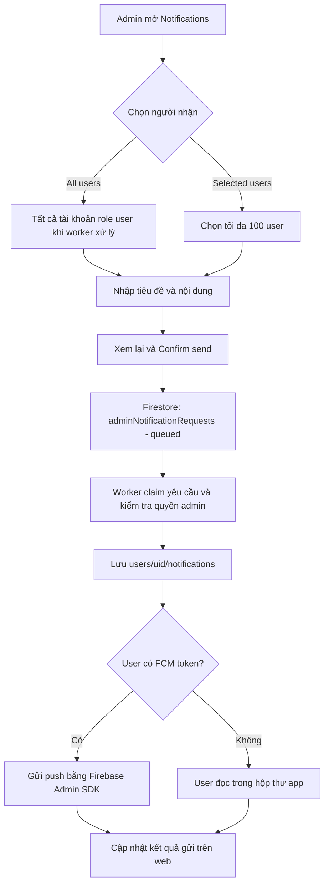
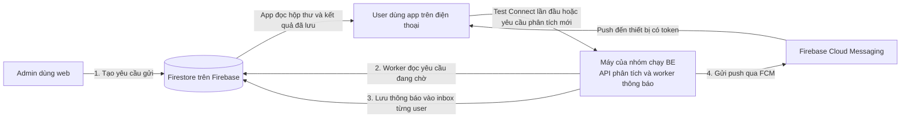

# Thông báo từ admin và hosting web

Web admin có hai chế độ gửi: **All users** và **Selected users**. Thông báo được lưu vào hộp thư trong app bằng Firestore; Firebase Cloud Messaging (FCM) gửi thêm push đến thiết bị đã đăng ký token. User không có thiết bị vẫn đọc được thông báo trong app khi đăng nhập lại.

[Preview màn gửi thông báo](images/admin-notifications-web-preview.png) dùng dữ liệu demo, chụp bằng Chromium.

## 1. Luồng hoạt động



Web không cần gọi HTTP tới laptop hoặc mở Tailscale để gửi yêu cầu này. Worker đọc hàng đợi từ Firestore bằng kết nối ra ngoài. Khi worker tắt, yêu cầu vẫn ở trạng thái **Queued** đến khi worker chạy lại.

| Chế độ | Người nhận |
|---|---|
| All users | Tất cả hồ sơ `users/{uid}` có role `user`, hoặc chưa có trường role, tại thời điểm xử lý; không gửi admin |
| Selected users | Danh sách UID đã chọn, tối đa 100 mỗi yêu cầu; user đã bị xóa hoặc chuyển thành admin sẽ bị bỏ qua |

Tiêu đề tối đa 80 ký tự, nội dung tối đa 500. Form mặc định chọn **Selected users**. Bấm **Review message** để xem lại, sau đó **Confirm send** mới tạo yêu cầu.

### Ai chạy BE, ai dùng app?

**Một máy của nhóm chạy backend để phục vụ nhiều user. Mỗi user cài app trên điện thoại và kết nối tới máy đó.** Máy chạy backend có thể là laptop của một thành viên hoặc máy chủ được nhóm triển khai sau này.

Backend đầy đủ có hai việc liên quan ở đây: API nhận lệnh phân tích bài báo, còn worker thông báo đọc yêu cầu admin trong Firestore và gửi thông báo. Khi chạy backend mới, worker tự chạy cùng; không cần bật thêm một worker riêng.



Ví dụ: máy A của nhóm chạy BE, bạn mở web admin trên máy B và một người khác dùng app trên điện thoại C. Web B tạo yêu cầu trong Firestore; worker trên A đọc và xử lý; điện thoại C đọc inbox từ Firestore và nhận push qua FCM. Ba thiết bị không cần cùng một máy. Điện thoại vẫn cần truy cập được địa chỉ BE qua Tailscale cho màn Connect và các lệnh phân tích.

### BE tắt thì user có mở app được không?

Source hiện tại phân biệt **đã lưu địa chỉ server** với **server đang hoạt động**:

| Tình huống | Cần BE đang chạy? | Lý do |
|---|---|---|
| Đăng nhập rồi thiết lập Connect lần đầu | Có | App chỉ cho lưu địa chỉ sau khi Test gọi API health thành công |
| Mở lại app sau khi đã lưu địa chỉ server | Không bắt buộc | Router chỉ kiểm tra có địa chỉ đã lưu, không gọi health ở mỗi lần mở |
| Xem bài đã có kết quả, lịch sử hoặc hộp thư | Không | App đọc dữ liệu từ Firebase; vẫn cần đăng nhập và quyền truy cập phù hợp |
| Yêu cầu phân tích bài mới | Có | API và pipeline của BE xử lý bài báo |
| Admin tạo yêu cầu gửi thông báo | Không | Web ghi yêu cầu vào Firestore, giữ trạng thái Queued nếu worker tắt |
| Xử lý yêu cầu thông báo mới thành inbox và push | Có worker đang chạy | Worker lấy yêu cầu, lưu inbox và gọi FCM |

**Worker thông báo chạy riêng chỉ phục vụ thông báo. Nó không có API health hoặc API phân tích, nên không thay thế backend đầy đủ ở bước Connect lần đầu.**

Đối chiếu source: [`app_router.dart`](../lib/app_router.dart) kiểm tra đăng nhập và địa chỉ đã lưu; [`connect_view_model.dart`](../lib/viewmodels/connect_view_model.dart) test health trước khi lưu; [`notifications_view_model.dart`](../lib/viewmodels/notifications_view_model.dart) đọc hộp thư trực tiếp qua Firestore.

## 2. Chạy thử giao diện ngay

```bash
cd admin-web
npm ci
npm run dev
```

Mở **http://localhost:5173/demo/notifications**. Có ba user mẫu, gồm một người chỉ có inbox. Kết quả gửi được mô phỏng trong memory và ghi rõ **Demo message simulated**; không kết nối Firebase hoặc gửi thông báo thật.

## 3. Kết nối gửi thật

### Publish Rules mới

Trong Firebase Console của **`realtron-874ac`** → Firestore Database → Rules, thay bằng nội dung [`firebase/firestore.rules`](../firebase/firestore.rules), rồi **Publish**. Rules mới có hai collection `adminUserDirectory` và `adminNotificationRequests`; bản Rules chỉ dành cho dashboard trước đó chưa đủ.

Tài khoản đăng nhập web phải có `users/{uid}.role = "admin"`. Cấu hình Web app nằm trong `admin-web/.env.local`, như hướng dẫn [Admin Dashboard](ADMIN_DASHBOARD.md). Service account chỉ đặt trên máy chạy backend.

### Chạy worker

Có hai cách, chọn một:

**A. Backend đầy đủ của nhóm:** chạy lại backend theo [`backend/README.md`](../backend/README.md). Factory `orchestrator.main:build_app` tự khởi động worker thông báo cùng service. Máy chủ này vẫn cần các dependency phân tích hiện tại.

**B. Chỉ thử thông báo:** chạy worker độc lập, không cần Saffron, RefChecker, GROBID, Android SDK hoặc cổng HTTP. Ví dụ trên Linux, từ thư mục gốc repo:

```bash
cd backend
python3 -m venv .venv-notifications
.venv-notifications/bin/python -m pip install -r requirements-notifications.txt
export GOOGLE_APPLICATION_CREDENTIALS="/duong/dan/tuyet/doi/service-account.json"
.venv-notifications/bin/python -m orchestrator.notification_worker
```

Dùng Python 3.12 như backend. Khóa lấy từ Firebase Console → Project settings → Service accounts và phải thuộc đúng project. Không đưa khóa vào frontend hoặc commit vào Git. Worker cũng đọc `backend/.env` nếu file đó tồn tại; có thể đặt biến đường dẫn khóa ở đó.

**Khởi động worker sẽ xử lý các yêu cầu thật đang Queued.** Không cần chạy thêm bản độc lập nếu backend đầy đủ đã đang chạy.

Worker đồng bộ danh sách user ngay lần đầu và khoảng mỗi 60 giây; kiểm tra yêu cầu mới mỗi 10 giây khi rảnh. Sau khi chạy, mở **http://localhost:5173/notifications**, chọn một tài khoản user thử trước và kiểm tra lịch sử gửi phía dưới form.

### Phía app user

App lưu token FCM vào `users/{uid}.fcmTokens` sau khi đăng nhập và đăng ký messaging. Nếu chưa có token, thông báo chỉ có trong inbox. Để thử push, app cần quyền thông báo trên thiết bị và kết nối mạng.

Build/cài lại app từ source mới để có cách xử lý `admin_message`:

- Khi app đang mở, push hiện snackbar; **View** mở màn Notifications.
- Khi bấm push từ nền hoặc lúc mở app, chuyển đến Notifications.
- Bấm thông báo admin trong danh sách để đọc toàn bộ nội dung; mục đó được đánh dấu đã đọc.
- Thông báo hoàn tất phân tích vẫn mở bài báo như trước.

## 4. Dữ liệu và phân quyền

| Đường dẫn | Nội dung | Quyền client |
|---|---|---|
| `adminUserDirectory/{uid}` | Tên, email, role, đã khóa hay chưa, cờ có thiết bị, ngày tạo, lần đăng nhập cuối | Admin chỉ đọc; worker đồng bộ từ hồ sơ user và Firebase Auth |
| `adminNotificationRequests/{requestId}` | Nội dung, audience, UID người nhận, `analysisId` (tùy chọn), `sendAt` (tùy chọn), admin gửi, thời gian, trạng thái, thống kê và `readCount` | Admin tạo yêu cầu `queued`, đọc, và hủy khi còn `queued`; không sửa nội dung |
| `users/{uid}/notifications/admin-{requestId}` | Thông báo trong app, `type = admin_message`, `analysisId` nếu có, `read`, thời gian | Chỉ chủ tài khoản đọc và đổi `read`; backend ghi nội dung |
| `users/{uid}.fcmTokens` | Token thiết bị | Không đưa vào danh sách user của web |

Worker kiểm tra lại role admin lúc bắt đầu và trước mỗi người nhận. Transaction chỉ cho một worker claim cùng yêu cầu. Inbox dùng ID cố định theo yêu cầu để tránh tạo hai mục và không reset trạng thái đã đọc. Nếu web chưa nhận được phản hồi ghi, thử lại cùng nội dung trong lần thao tác đó giữ nguyên request ID.

Danh sách user trên web là bản đồng bộ, có thể chậm khoảng một phút (đổi role hoặc khóa tài khoản trên web thì cập nhật ngay). Danh sách có cả admin để trang Users dùng, nhưng người nhận thông báo chỉ là role `user`. Không có token; admin không được đọc toàn bộ hồ sơ riêng, thư viện hoặc token của user khác.

## 5. Đọc kết quả gửi

| Trạng thái | Ý nghĩa |
|---|---|
| Queued | Firestore đã nhận yêu cầu, worker chưa xử lý |
| Processing | Một worker đang xử lý |
| Completed | Hoàn thành các mục inbox và các lượt gửi push có token |
| Needs review | Có người nhận bị bỏ qua, lỗi inbox, push thất bại hoặc kết quả push chưa chắc chắn |
| Failed | Yêu cầu không hợp lệ, không còn quyền gửi hoặc không có user phù hợp trước khi lưu inbox |
| Interrupted | Worker gặp lỗi hoặc dừng giữa chừng; không tự gửi lại |
| Scheduled | Đang chờ đến giờ hẹn; có thể hủy |
| Cancelled | Admin đã hủy trước khi worker xử lý; không ai nhận |

**Inbox stored** tính theo user, **FCM accepted/failed** tính theo token thiết bị. Một user có thể có nhiều thiết bị. **FCM accepted không xác nhận thiết bị đã hiển thị hoặc user đã đọc**; **Without device** vẫn có thông báo trong inbox.

Yêu cầu Processing không cập nhật hơn 10 phút được chuyển sang Interrupted khi worker kiểm tra lại. Không tự phát lại push sau kết quả mạng không chắc chắn vì có thể gây trùng. Xem số liệu trước khi chủ động tạo yêu cầu mới. Web giữ 30 yêu cầu gần nhất.

### Link bài, hẹn giờ, nhóm chọn nhanh và tỷ lệ đã mở

- **Link to a paper:** chọn một bài đã hoàn thành. Worker lưu `analysisId` vào inbox và dữ liệu push. Trên app, chạm push mở thẳng Overview của bài; trong hộp thư, hộp thoại hiện đủ nội dung kèm nút **Open paper**.
- **Schedule:** chọn giờ giao từ 5 phút đến 30 ngày tới (theo giờ máy của admin). Worker bỏ qua yêu cầu chưa đến giờ và kiểm tra lại trong transaction claim. Trước giờ giao có thể bấm **Cancel this message**; Rules chỉ cho đổi `queued` → `cancelled`, nên không thể hủy khi worker đã bắt đầu gửi.
- **Quick select:** chọn nhanh user có bài gần nhất bị lỗi, có bài đang chạy, chưa phân tích bài nào, không đăng nhập 30 ngày, hoặc có thiết bị push (tối đa 100 người).
- **Opened in the app:** cứ 15 phút worker đếm số mục inbox đã mở (`read = true`) cho các yêu cầu hoàn thành trong 7 ngày, bằng một truy vấn count cho mỗi yêu cầu, và ghi `readCount`. Cần index collection group `notifications (requestId, read)` trong [`firebase/firestore.indexes.json`](../firebase/firestore.indexes.json); deploy bằng `firebase deploy --only firestore:indexes`. "Đã mở" nghĩa là user mở tin trong hộp thư của app.

## 6. Host web lên Firebase Hosting

Web này là ứng dụng static, có thể host để mở bằng URL HTTPS. File [`admin-web/firebase.json`](../admin-web/firebase.json) đã cấu hình thư mục `dist`, SPA fallback về `index.html` và target **`admin-web`**. Chưa tạo site hoặc deploy lên Firebase thật.

Các lệnh dưới đây dành cho lúc nhóm quyết định publish. Chạy trong `admin-web/`, thay `your-unique-admin-site` bằng một site ID duy nhất mà nhóm chọn:

```bash
npx firebase-tools login
npx firebase-tools hosting:sites:create your-unique-admin-site --project realtron-874ac
npx firebase-tools target:apply hosting admin-web your-unique-admin-site --project realtron-874ac
npm run build
npx firebase-tools deploy --only hosting:admin-web --project realtron-874ac
```

Nếu đã có site dành riêng cho admin, bỏ bước tạo site và bind target vào site đó. Target được lưu local trong `.firebaserc` (gitignored). Kiểm tra target trước khi deploy để đưa web lên đúng site. Lệnh trên chỉ deploy Hosting; vẫn phải publish Firestore Rules riêng.

Trong Firebase Authentication → Settings → Authorized domains, thêm hostname thực tế, ví dụ `your-unique-admin-site.web.app`, trước khi thử Google Sign-In. Build phải được thực hiện với `.env.local` của đúng Firebase Web app.

Host web xong thì tắt laptop vẫn mở được dashboard và tạo yêu cầu. Để thông báo được xử lý ngay khi laptop tắt, worker phải chạy trên máy chủ khác hoặc dịch vụ luôn bật, với service account chỉ lưu phía server.

Tham khảo: [Firebase Hosting multisite và deploy target](https://firebase.google.com/docs/hosting/multisites), [FCM với Admin SDK](https://firebase.google.com/docs/cloud-messaging/send/admin-sdk).

## 7. Đã kiểm tra và phần cần thử thực tế

Lần kiểm tra ngày 12/11/2026, sau khi thêm link bài, hẹn giờ, hủy, nhóm chọn nhanh và tỷ lệ đã mở:

- Web: TypeScript, 65 unit/component tests và 8 Playwright tests desktop/mobile.
- Backend: 133 tests pass; 13 adapter tests riêng pass trên Firestore emulator, thêm heartbeat, directory có Auth, link bài, hẹn giờ, đếm đã đọc, hàng đợi thao tác admin, xóa analysis và đổi role/khóa tài khoản (Auth giả). Test claim đồng thời có lúc báo `Transaction lock timeout` ở lần chạy đầu của emulator và pass khi chạy lại.
- Firestore Rules: 14 tests pass trên emulator.
- Flutter: `flutter analyze lib test` không có lỗi và 170 tests pass.

Lần kiểm tra ngày 11/11/2026 (tính năng gửi ban đầu): 21 unit và 6 Playwright tests ở web, 101 tests backend, 5 adapter tests, 9 Rules tests, 166 tests Flutter.

Chưa gửi thông báo lên FCM thật, chưa kiểm tra hiển thị trên điện thoại và chưa deploy Hosting. Máy triển khai chưa có service account, nên chưa khởi động worker với Firebase thật. Các kiểm tra adapter dùng emulator và mock FCM, không gửi tới user thực.
