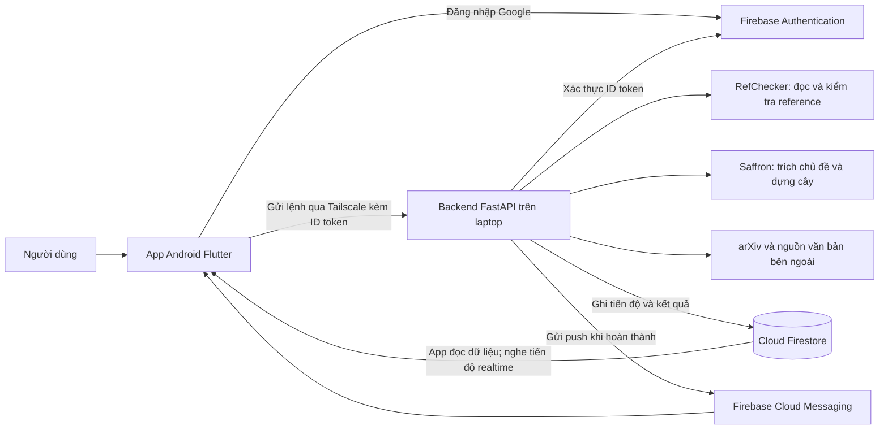
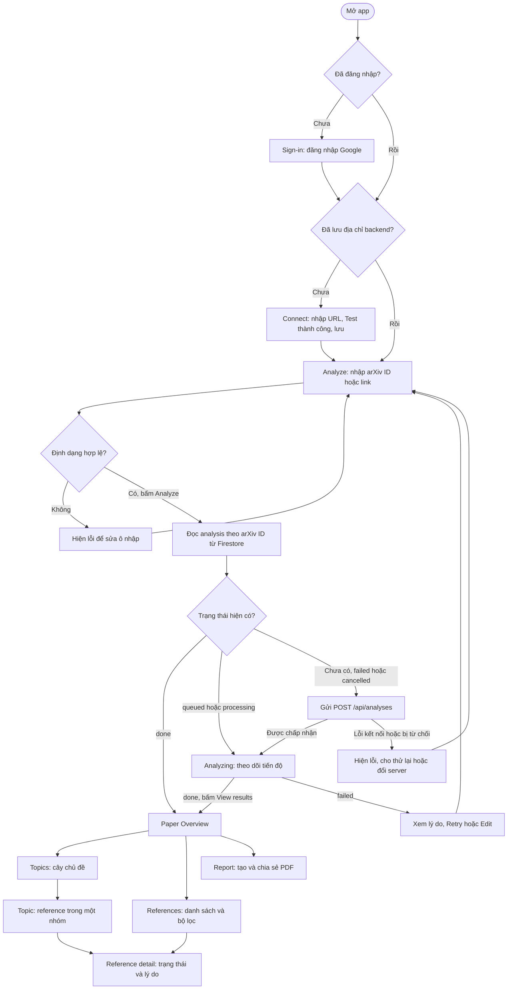
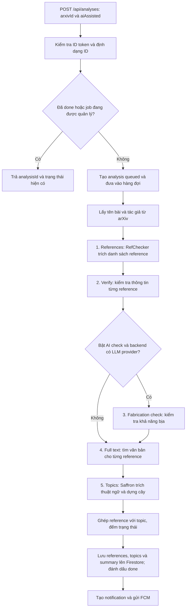
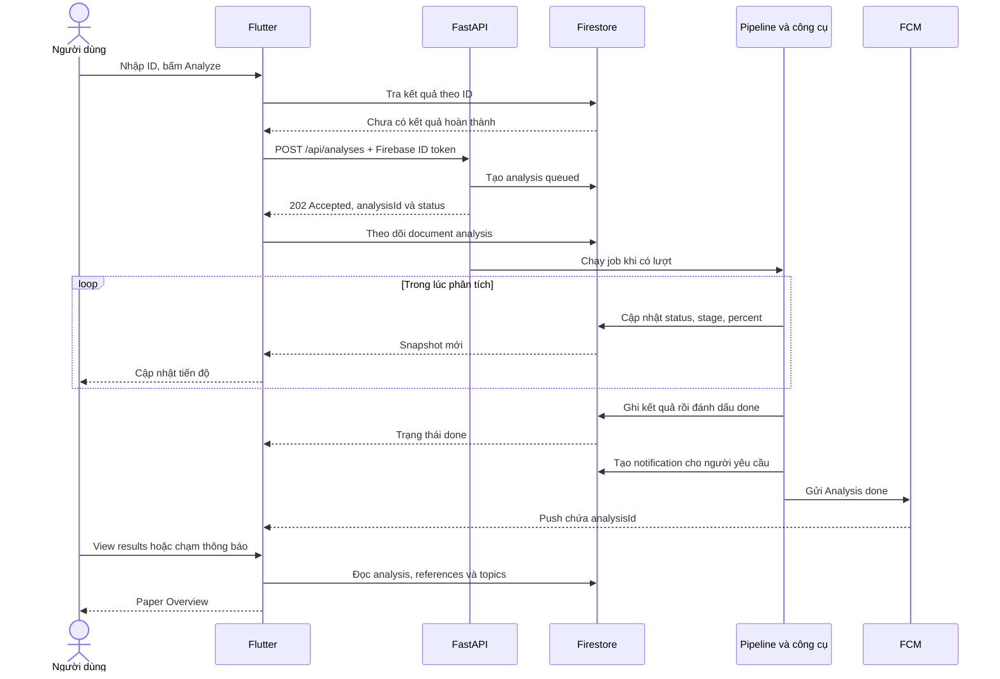
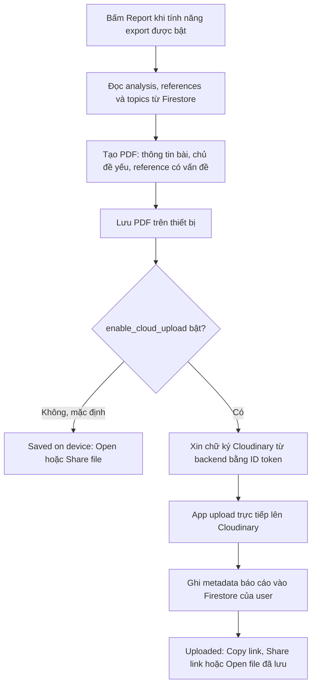
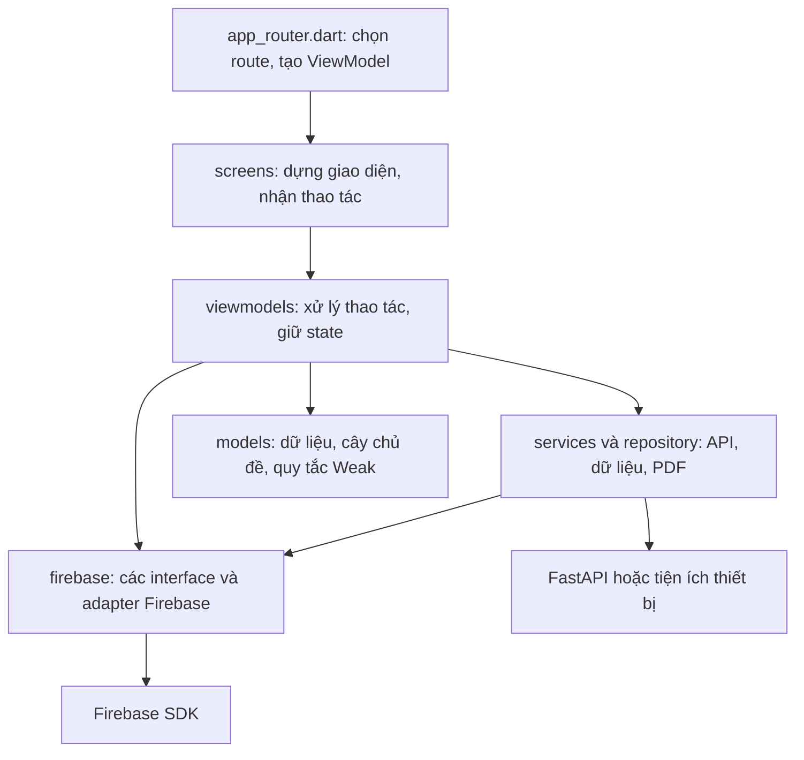

# Realtron hoạt động như thế nào?

Tài liệu nhập môn dựa trên source hiện tại. Đọc từ mục 1 đến mục 6 để nắm sản phẩm; mục 7 và 8 giúp tìm code khi cần làm tiếp.

Các sơ đồ thao tác dưới đây mô tả luồng user trong app Android. Web admin riêng nằm trong `admin-web/` để theo dõi phân tích bằng trình duyệt; xem [Admin Dashboard](ADMIN_DASHBOARD.md).

Nếu đang thắc mắc **ai cần chạy backend, user mở app bằng cách nào và khi BE tắt thì sao**, đọc phần [Ai chạy BE, ai dùng app?](ADMIN_NOTIFICATIONS.md#ai-chạy-be-ai-dùng-app) trước. Phần đó có sơ đồ web admin → Firestore → worker → FCM → app và bảng tình huống cần backend.

## 1. Dự án giải quyết vấn đề gì?

Một bài báo khoa học thường trích dẫn nhiều công trình khác ở phần References. Người đọc muốn biết: bài này dựa trên những mảng kiến thức nào, các tài liệu được dẫn có đáng tin không, và nhóm chủ đề nào có nhiều reference gặp vấn đề?

**Realtron nhận một arXiv ID hoặc link bài báo, kiểm tra reference của bài đó, nhóm chúng thành cây chủ đề và cho người dùng xem chi tiết hoặc xuất PDF.**

Ba khái niệm cần phân biệt:

| Khái niệm | Ý nghĩa trong app |
|---|---|
| Paper / bài báo đầu vào | Bài người dùng muốn phân tích, ví dụ ID `1706.03762` |
| Reference | Một tài liệu được bài đầu vào trích dẫn |
| Topic / chủ đề | Nhóm thuật ngữ, chủ đề được rút ra từ văn bản của các reference |

Ví dụ minh họa, không phải kết quả thật: bạn nhập bài A có 20 reference. Hệ thống kiểm tra từng reference, rồi gom chúng vào các nhóm như Machine Learning, NLP và Optimization. Bạn mở nhóm NLP để xem nhóm này có những reference nào, reference nào sai thông tin hoặc có khả năng bị bịa.

## 2. Những thành phần nào cùng hoạt động?



| Thành phần | Vai trò dễ hiểu |
|---|---|
| Flutter | Giao diện, nhập bài, xem kết quả, lịch sử, xuất PDF |
| FastAPI Orchestrator | Nhận yêu cầu và điều phối các bước xử lý nặng |
| RefChecker | Trích danh sách reference, kiểm tra thông tin; có thể kiểm tra khả năng bịa khi có cấu hình LLM |
| Saffron | Rút thuật ngữ và dựng quan hệ chủ đề từ tập văn bản reference |
| Firestore | Lưu kết quả chung và dữ liệu riêng từng người; app theo dõi tiến độ tại đây |
| Firebase Auth | Đăng nhập và cấp ID token để backend xác định người gửi lệnh |
| FCM | Báo phân tích đã xong, hỗ trợ mở bài từ thông báo |
| Tailscale | Kết nối điện thoại với máy chạy backend qua mạng riêng |

**Có hai đường trao đổi dữ liệu:** app gọi API backend để bắt đầu, dừng phân tích hoặc xin chữ ký upload; app đọc tiến độ và kết quả trực tiếp từ Firestore. Backend không cần trả cả bộ kết quả qua HTTP cho điện thoại.

## 3. Người dùng đi qua những màn nào?



App có ba tab chính: **Analyze**, **History**, **Profile**. Notifications mở từ biểu tượng chuông hoặc Profile. Màn đang phân tích được mở riêng, không có thanh tab dưới.

Một vài hành vi cần biết:

- Input có thể là ID, link arXiv hoặc link được share từ trình duyệt. App bỏ hậu tố phiên bản: `1706.03762v5` trở thành `1706.03762`.
- Kết quả được tra theo arXiv ID. Nếu đã `done`, app dùng lại; nếu đang chạy, app theo dõi job đó.
- Khi mở hoặc gửi phân tích thành công, app thêm/cập nhật bài trong lịch sử riêng của người dùng.
- Có thể rời màn và để backend chạy tiếp; hoàn thành thì backend tạo thông báo và gửi push nếu có token thiết bị.
- Nút Stop gọi backend; API chỉ cho người khởi tạo job dừng job đó.

## 4. Sau khi bấm Analyze, backend làm gì?

### 4.1. Năm bước xử lý



Đây là các giai đoạn nghiệp vụ. Trong code, References, Verify và Fabrication cùng nằm trong lần chạy RefChecker; backend dùng sự kiện từ tiến trình đó để cập nhật stepper của app. Stepper vẫn có năm nhãn, dù kiểm tra bịa có thể được bỏ qua.

**Văn bản đưa vào Saffron đến từ từng reference**, theo thứ tự ưu tiên:

1. Toàn văn PDF từ arXiv hoặc link PDF công khai đã tìm được.
2. Abstract nếu không lấy được toàn văn.
3. Tiêu đề kèm ngữ cảnh trích dẫn nếu không có cả hai nguồn trên.

Saffron trả về thuật ngữ gắn với từng tài liệu và cây chủ đề. Backend ghép chúng với reference, giữ tối đa 5 liên kết chủ đề mạnh nhất cho mỗi reference theo điểm tf-idf. Reference không được gán chủ đề sẽ xuất hiện trong nhóm **Unclassified**.

### 4.2. Vì sao điện thoại thấy tiến độ dù API đã trả về?



Backend mặc định chạy **một job tại một thời điểm**; các job khác chờ lượt. Lỗi ở bước xử lý đưa analysis về `failed`. Dừng job đưa về `cancelled`. Khi backend khởi động lại, các analysis còn `queued` hoặc `processing` được đánh dấu `failed` để app không chờ một job đã mất.

Kết quả RefChecker còn được giữ trong thư mục làm việc của backend để lần thử lại có thể dùng lại. Vì vậy Retry không nhất thiết chạy mới mọi bước. Gửi push lỗi sau khi lưu kết quả không làm analysis từ `done` thành thất bại.

## 5. Kết quả được hiểu như thế nào?

### 5.1. Trạng thái của reference

| Trạng thái | Cách hiểu khi đọc kết quả |
|---|---|
| Verified | Công cụ báo reference đã được xác minh |
| Warning | Có cảnh báo, chẳng hạn khác biệt nhỏ về metadata |
| Error | Có lỗi trong thông tin reference |
| Hallucinated | Công cụ đánh giá reference có khả năng bị bịa; cần kiểm tra nguồn |
| Unverified | Chưa xác minh được; không có nghĩa là chắc chắn sai |

Màn Reference detail có thể hiện bảng **Cited / Actual**: thông tin bài đã dẫn so với thông tin công cụ tìm thấy. Reference có lỗi hỗ trợ Copy fix; reference nghi bịa có phần giải thích và kết quả gần khớp nếu có dữ liệu.

### 5.2. Khi nào một chủ đề bị gắn Weak?

App đếm các reference của chủ đề và toàn bộ chủ đề con, loại trùng theo ID, rồi áp dụng:

```text
Tỷ lệ vấn đề = (số Error + số Hallucinated) / tổng reference của nhóm

Weak khi:
  tổng reference >= weak_topic_min_refs
  VÀ tỷ lệ vấn đề >= weak_topic_threshold

Mặc định: ít nhất 3 reference và tỷ lệ ít nhất 50%.
```

Ví dụ minh họa: nhóm NLP có 4 reference, gồm 1 Error, 1 Hallucinated và 2 Verified. Tỷ lệ là `2 / 4 = 50%`, đủ số lượng tối thiểu, nên nhóm được gắn Weak. Nhóm chỉ có 2 reference đều Error vẫn chưa đạt điều kiện tối thiểu 3.

**Warning không được tính vào tử số của quy tắc Weak.** Các giá trị ngưỡng lấy từ Firebase Remote Config. Overview, Topics, Topic detail và PDF dùng chung quy tắc này.

Weak mô tả vấn đề ở tài liệu tham khảo của nhóm; nhãn này không tự chứng minh nội dung hoặc kết luận khoa học của bài đầu vào là sai.

## 6. Xem lại, thông báo và xuất PDF

### 6.1. Kết quả chung, lịch sử riêng

```text
analyses/{arxivId}                         Kết quả chung của một bài
  references/{refId}                       Các reference và trạng thái
  topics/{topicId}                         Các chủ đề và liên kết reference

users/{uid}                               Hồ sơ và token thiết bị
  library/{arxivId}                        Lịch sử, tên tùy chỉnh, thời gian mở
  notifications/{notificationId}           Thông báo trong app
  reports/{reportId}                       Metadata báo cáo đã upload
```

Người dùng đã đăng nhập được đọc kết quả chung; app không được tự ghi kết quả phân tích. Backend ghi chúng bằng Firebase Admin SDK. Dữ liệu dưới từng `users/{uid}` được giới hạn cho chính người đó theo rules.

Vì kết quả chung được dùng lại theo arXiv ID, nhiều người có thể xem cùng một analysis. Đổi tên hoặc xóa bài trong History chỉ tác động lịch sử riêng, không đổi tên bài gốc hoặc xóa analysis chung.

Backend bình thường tạo thông báo hoàn thành cho người gửi job. Khi app đang mở, push hiện bằng snackbar; chạm thông báo có `analysisId` sẽ điều hướng tới Overview, sau khi đáp ứng điều kiện đăng nhập và cấu hình server.

Web admin có thêm luồng thông báo riêng, không phụ thuộc bài báo: chọn **All users** hoặc **Selected users** → nhập nội dung → xác nhận → tạo `adminNotificationRequests` trong Firestore. Worker kiểm tra quyền admin, lưu thông báo `admin_message` vào inbox từng user và gửi FCM nếu có token. Bấm push này mở Notifications; bấm mục inbox mở toàn bộ nội dung. Worker đồng bộ danh sách người nhận qua `adminUserDirectory`, không đưa token lên web. Chi tiết và sơ đồ Mermaid: [`ADMIN_NOTIFICATIONS.md`](ADMIN_NOTIFICATIONS.md).

### 6.2. Xuất báo cáo



PDF liệt kê các reference có trạng thái Error, Hallucinated hoặc Warning. Đây là phạm vi rộng hơn tử số dùng để tính Weak.

Triển khai hiện tại inject Cloudinary cho phần upload; mặc định `enable_cloud_upload = false`, nên chỉ lưu PDF trên máy. Khi bật upload, backend cần đang chạy để ký yêu cầu và có cấu hình Cloudinary.

## 7. Code được chia ra sao?



App dùng **MVVM + Provider**: screen nhận thao tác, gọi ViewModel và hiển thị state. ViewModel gọi các service/repository được truyền vào. `app_dependencies.dart` tạo các implementation cụ thể một lần và cung cấp qua Provider. Widget dùng theme và token trong `lib/theme/` để thống nhất giao diện.

Các file nên đọc theo thứ tự nếu muốn lần theo luồng Analyze:

| File | Đọc để hiểu |
|---|---|
| [lib/main.dart](../lib/main.dart) | Khởi tạo Firebase, app, listener push và share intent |
| [lib/app_router.dart](../lib/app_router.dart) | Chặn theo đăng nhập/server và tạo các màn |
| [lib/viewmodels/analyze_view_model.dart](../lib/viewmodels/analyze_view_model.dart) | Kiểm tra input, dùng lại kết quả, gửi yêu cầu |
| [lib/services/api_client.dart](../lib/services/api_client.dart) | HTTP và Firebase ID token |
| [backend/orchestrator/main.py](../backend/orchestrator/main.py) | API nhận lệnh, xác thực và kiểm tra quyền dừng |
| [backend/orchestrator/jobs.py](../backend/orchestrator/jobs.py) | Hàng đợi, pipeline, tiến độ và trạng thái kết thúc |
| [backend/orchestrator/steps.py](../backend/orchestrator/steps.py) | Chạy RefChecker, lấy văn bản, gọi Saffron |
| [backend/orchestrator/merge.py](../backend/orchestrator/merge.py) | Chuẩn hóa kết quả và ghép topic với reference |
| [backend/orchestrator/store.py](../backend/orchestrator/store.py) | Ghi Firestore và gửi FCM |
| [lib/viewmodels/progress_view_model.dart](../lib/viewmodels/progress_view_model.dart) | Nghe tiến độ từ Firestore, Stop và Retry |
| [lib/models/topic_tree.dart](../lib/models/topic_tree.dart) | Dựng cây và đếm reference không trùng |
| [lib/models/weak_topic_rule.dart](../lib/models/weak_topic_rule.dart) | Quy tắc gắn nhãn Weak |
| [lib/viewmodels/export_view_model.dart](../lib/viewmodels/export_view_model.dart) | Tạo PDF, lưu file và upload tùy cấu hình |

## 8. Những giới hạn cần nhớ khi dùng app

- App hiện nhận arXiv ID định dạng mới; chưa nhận file PDF người dùng tải lên hoặc ID cũ có dạng `hep-th/9901001`.
- Bật AI check trên điện thoại chỉ có tác dụng chạy phần LLM nếu backend cũng đã cấu hình LLM provider/key. Không chạy kiểm tra bịa thì số Hallucinated bằng 0 không chứng minh mọi reference đều có thật.
- Theo tài liệu backend, Saffron đang dùng model thay thế; chất lượng cây chủ đề chưa được đánh giá bài bản.
- Backend tắt: người đã đăng nhập và lưu server vẫn có thể đọc kết quả từ Firestore khi có mạng. Nếu điện thoại cũng mất mạng, chỉ đọc được phần dữ liệu đã có trong cache. Lần thiết lập server đầu tiên vẫn cần Test kết nối thành công.
- Remote Config còn điều khiển số bài Recent và việc hiện nút Report. Analytics ghi sự kiện sử dụng; Crashlytics ghi lỗi. Chúng không thực hiện pipeline kiểm tra reference.

Tài liệu này mô tả luồng theo source, chưa phải xác nhận đã chạy thành công với điện thoại, Firebase và các công cụ thật trên máy hiện tại. Xem thêm [kiến trúc chi tiết](architecture.md), [user flow](../design/user-flow.md) và [hướng dẫn chạy](../HUONG_DAN_CHAY.md).
