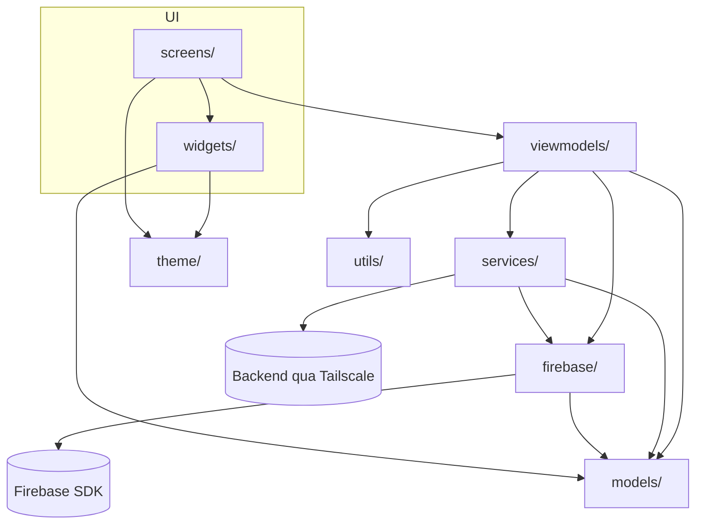
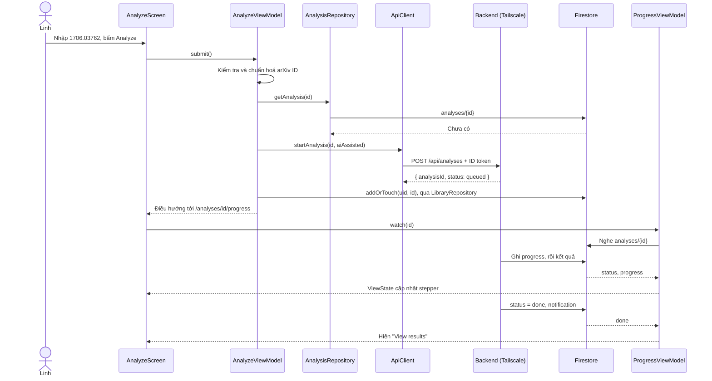

# Architecture: Realtron

> MVVM + Provider. Phụ thuộc chỉ đi xuống; một tầng không bao giờ import tầng trên nó.
> Mô hình dữ liệu Firestore và hợp đồng API của backend ở mục 7 và 8.

## 1. Cây thư mục

```
lib/
├── main.dart              # Khởi tạo Flutter và Firebase, khoá màn dọc, chạy app
├── app_dependencies.dart  # Composition root: tạo service một lần, inject qua Provider
├── app_router.dart        # Route, chặn theo đăng nhập và server
├── app_routes.dart        # Mọi đường dẫn điều hướng, dựng ở một chỗ
├── theme/                 # Token, ThemeData, ThemeExtension (màu trạng thái, chữ mono)
├── models/                # Dữ liệu thuần: RefStatus, StatusCounts, Analysis, Topic, WeakTopicRule…
├── utils/                 # Hàm thuần không phụ thuộc UI: arXiv ID, địa chỉ server, định dạng thời gian
├── firebase/              # Bọc Firebase SDK: Auth, Firestore, Storage, Messaging, Analytics, Crashlytics, Remote Config
├── services/              # Backend qua Tailscale, repository, tạo PDF, nhận link share
├── viewmodels/            # Một ViewModel mỗi màn + ViewState; chứa toàn bộ logic nghiệp vụ
├── screens/               # Dựng UI từ state của ViewModel; không có logic, không gọi SDK
└── widgets/               # Component của design system, trạng thái truyền qua tham số
test/                      # Unit test ViewModel (service giả), widget test design system
e2e_test/                  # Test ARTEMIS (pytest)
backend/                   # Orchestrator FastAPI: chạy RefChecker, Saffron; ghi Firestore, gửi FCM
admin-web/                 # React/TypeScript/Vite: dashboard và gửi thông báo admin
firebase/                  # storage.rules, firestore.rules, indexes, remote-config-defaults.json
design/                    # Persona, flow, DESIGN.md, nhật ký AI, ảnh Stitch
handoff/                   # flutter-handoff.md
docs/                      # Traceability, architecture, analytics, test plan, code review
evidence/                  # Ảnh Console, DebugView, Crashlytics, trace ARTEMIS
```

Khác cấu trúc gợi ý của đề ở hai điểm:
- `lib/theme/` được tách riêng, đúng yêu cầu mục 5 của đề.
- Có thêm `design/` và `handoff/` ở gốc, vì đề coi chúng là đặc tả của app.

Backend (Orchestrator) nằm ở `backend/`, tách khỏi code Flutter, và gọi RefChecker, Saffron như công cụ bên ngoài: mã nguồn của hai dự án đó không nằm trong repo. Đề không có thư mục này trong cấu trúc gợi ý; thêm vào vì đề tài cần một service riêng.

## 2. Sơ đồ tầng



**Quy tắc (đề chấm trực tiếp):**
1. Widget và screen không gọi `http`, `dio`, `FirebaseAuth.instance`, `FirebaseAnalytics.instance` hay SDK nào. Mọi lời gọi ra ngoài đi qua service.
2. Lọc, sắp xếp, tổng hợp, kiểm tra hợp lệ nằm trong ViewModel hoặc service, không nằm trong `build()`.
3. Mỗi màn có tải dữ liệu có `ViewState<T>` (`Loading` / `Empty` / `Failure` / `Data`), do ViewModel giữ.
4. Service được inject qua Provider, nên ViewModel test được bằng service giả.
5. Không có biến toàn cục thay đổi được.
6. Màu, cỡ chữ, khoảng cách lấy từ theme và token, không ghi cứng trong screen.

## 3. Sequence diagram: Flow A (phân tích bài mới)



## 4. ViewModel ↔ service

| ViewModel | Màn | Service được inject |
|---|---|---|
| `AuthViewModel` | Sign-in, router | `AuthService`, `AnalyticsService`, `CrashlyticsService`, `FirestoreService`, `MessagingService` |
| `ConnectViewModel` | Connect server | `ApiClient`, `ServerSettings`, `DeviceActions`, `CrashlyticsService` |
| `AnalyzeViewModel` | Analyze | `ApiClient`, `AnalysisRepository`, `LibraryRepository`, `LibraryFeed`, `AuthService`, `ServerSettings`, `RemoteConfigService`, `AnalyticsService`, `CrashlyticsService`, `DeviceActions` |
| `ProgressViewModel` | Analyzing | `AnalysisRepository`, `ApiClient`, `ServerSettings` |
| `OverviewViewModel` | Paper Overview | `AnalysisRepository`, `RemoteConfigService`, `AnalyticsService`, `CrashlyticsService` |
| `TopicMapViewModel` | Topics | `AnalysisRepository`, `RemoteConfigService`, `AnalyticsService` |
| `TopicDetailViewModel` | Topic | `AnalysisRepository`, `RemoteConfigService`, `AnalyticsService` |
| `ReferenceListViewModel` | References | `AnalysisRepository` |
| `ReferenceDetailViewModel` | Reference | `AnalysisRepository`, `DeviceActions`, `AnalyticsService` |
| `HistoryViewModel` | History | `LibraryRepository`, `LibraryFeed`, `AuthService`, `CrashlyticsService` |
| `NotificationsViewModel` | Notifications | `FirestoreService`, `AuthService`, `AnalyticsService` |
| `ExportViewModel` | Sheet Export report | `ReportService`, `StorageService`, `FirestoreService`, `AnalysisRepository`, `RemoteConfigService`, `AuthService`, `AnalyticsService`, `CrashlyticsService`, `DeviceActions` |
| `ProfileViewModel` | Profile | `AuthService`, `ServerSettings`, `RemoteConfigService`, `AnalyticsService`, `CrashlyticsService`, `LibraryFeed` |

`ShareIntentService` và `MessagingService` được nghe ở `RealtronApp` trong `main.dart`, vì link share hay push có thể tới khi đang ở bất kỳ màn nào. App chuyển tới `/analyze?shared=…` hoặc `/analyses/:id`.

## 5. Design system trong code

- **Token:** `theme/app_tokens.dart` (palette, spacing, radius, size, elevation).
- **Theme:** `theme/app_theme.dart` dựng `ColorScheme`, `TextTheme` và theme của từng component.
- **Ngoài chuẩn Material:** `theme/app_theme_extensions.dart` có `StatusColors` và `AppTextExtras`. Đọc qua `context.status(...)`, `context.mono`, `context.muted`.
- **Component:** mỗi component trong Figma page 05 là một widget trong `widgets/` (`handoff/flutter-handoff.md` Bảng 2).
- **Kiểm chứng:** `test/widgets/design_system_test.dart` kiểm tra không tràn ở 360 / 412 dp với chữ 100% và 130%, vùng chạm và contrast theo guideline của Flutter.

## 6. Quyết định

| Quyết định | Lý do |
|---|---|
| Provider + `ChangeNotifier` | Đề cho phép Provider hoặc Riverpod; nhóm đã dùng Provider ở Lab 2 |
| go_router | Cần deep link từ push và chuyển màn theo auth state |
| Kết quả đọc từ Firestore, không qua REST | Có realtime và offline cache; xem lại được khi backend tắt |
| App chỉ gọi backend để ra lệnh | Backend chạy trên laptop, có thể tắt bất cứ lúc nào |
| Cây chủ đề nằm trong `models/topic_tree.dart`, quy tắc "chủ đề yếu" trong `models/weak_topic_rule.dart` | Overview, Topics, Topic và báo cáo PDF dùng chung một cách tính; đổi được qua Remote Config mà không build lại |
| Số đếm của chủ đề cha tính lại từ `refIds` của cả nhánh | Một reference nằm trong hai chủ đề con chỉ được đếm một lần |
| Chủ đề yếu: (Hallucinated + Error) / tổng ≥ `weak_topic_threshold` và tổng ≥ `weak_topic_min_refs` | Warning không tính, vì chỉ là khác biệt nhỏ về metadata |
| Push khi app đang mở hiện bằng snackbar | Không cần thêm thư viện local notification |
| Backend chạy một job mỗi lần, lệnh dừng diệt cả tiến trình con | Mỗi job tốn nhiều bộ nhớ và dễ chạm rate limit của API bên ngoài |
| Khởi động lại backend thì job đang chạy thành `failed` | Không thì app chờ mãi một job không còn tồn tại |
| Mỗi reference chỉ thuộc tối đa 5 chủ đề mạnh nhất (theo tf-idf) | Toàn văn nhắc đến hầu hết các thuật ngữ; nếu giữ hết thì chủ đề nào cũng chứa gần đủ reference và "chủ đề yếu" mất ý nghĩa |
| Sửa reference trong `.bbl` kiểu ACL trước khi kiểm tra (`orchestrator/bbl_repair.py`) | RefChecker đọc nhầm năm thành tiêu đề, nên tìm sai bài. Với `1508.04025`: 15/15 mất tiêu đề và 1 verified trước khi sửa; 0/15 và 9 verified sau khi sửa |
| Saffron dùng model thay thế (POS tải lại, mô hình dựng cây train lại) | Máy chủ model gốc đã ngừng hoạt động; xem `backend/README.md` |
| Gói Spark: PDF lưu trên máy, không upload (`enable_cloud_upload = false`) | Spark không có bucket Cloud Storage. Code upload vẫn giữ và có test, bật lại được qua Remote Config |
| `kotlin.incremental=false`, `compileSdk = 37` | Pub cache ở ổ C, dự án ở ổ D; `receive_sharing_intent` yêu cầu SDK 37 |

## 7. Firestore

| Đường dẫn | Trường | Ai ghi |
|---|---|---|
| `users/{uid}` | `displayName`, `photoUrl`, `createdAt`, `fcmTokens[]`, `role` | App |
| `users/{uid}/library/{arxivId}` | `customTitle`, `addedAt`, `lastOpenedAt` | App |
| `users/{uid}/reports/{id}` | `analysisId`, `storagePath`, `downloadUrl`, `sizeKb`, `createdAt`. Chỉ ghi khi `enable_cloud_upload` bật | App |
| `users/{uid}/notifications/{id}` | `title`, `body`, `type`, `analysisId` (analysis_done) hoặc `requestId` (admin_message), `createdAt`, `read` | Backend; app chỉ đổi `read` |
| `adminUserDirectory/{uid}` | `displayName`, `hasDevice`, `role`, `email`, `disabled`, `createdAt`, `lastSignInAt`, `updatedAt` | Worker (từ hồ sơ và Firebase Auth); admin chỉ đọc, không chứa token |
| `adminNotificationRequests/{id}` | `title`, `body`, `audience`, `recipientUids[]`, `analysisId?`, `sendAt?`, `requestedBy`, `createdAt`, `status`, `counts`, `error`, `readCount`, `readCheckedAt` | Admin tạo queued hoặc hủy khi còn queued; worker claim và ghi kết quả |
| `adminActions/{id}` | `type`, `target`, `requestedBy`, `createdAt`, `status`, `reason?`, `role?`, `disabled?`, `result`, `error`, `finishedAt` | Admin chỉ tạo queued; tiến trình API claim, thực hiện và ghi kết quả. Đồng thời là audit log |
| `workerStatus/{backend,notifications}` | `state`, `lastSeen`, `startedAt`, `version`, `intervalSeconds`, `runningJobs` | Backend ghi heartbeat khoảng mỗi phút; admin chỉ đọc |
| `analyses/{arxivId}` | `requestedBy`, `aiAssisted`, `createdAt`, `updatedAt`, `status` (`queued`, `processing`, `done`, `failed`, `cancelled`), `paperTitle`, `paperAuthors[]`, `progress`, `summary`, `topicSummary[]`, `hidden`, `hiddenReason`, `hiddenBy`, `hiddenAt`, `finishedAt`, `error` | Backend |
| `analyses/{id}/references/{refId}` | `index`, `title`, `authors[]`, `year`, `venue`, `url`, `status`, `issues[]`, `hallucination`, `textSource`, `topicIds[]` | Backend |
| `analyses/{id}/topics/{topicId}` | `term`, `parentId`, `depth`, `score`, `refIds[]`, `counts` | Backend |

`topicSummary` là danh sách `{term, depth, total, flagged}` của các chủ đề có reference Error/Hallucinated, để web xếp hạng chủ đề yếu mà không đọc từng subcollection `topics`. `hidden = true` nghĩa là admin đã ẩn kết quả; app hiện "Removed" và lý do thay cho kết quả.

Luồng thao tác admin: web tạo `adminActions/{id}` → tiến trình API claim bằng transaction → kiểm tra lại role → dừng/chạy lại/ẩn/xóa analysis, đổi role hoặc khóa tài khoản bằng Admin SDK → ghi kết quả.

Luồng thông báo admin: web tạo yêu cầu → worker kiểm tra role và người nhận → lưu inbox → FCM. Worker chạy cùng FastAPI hoặc độc lập; xem [`ADMIN_NOTIFICATIONS.md`](ADMIN_NOTIFICATIONS.md). Web không giữ service account hay đọc token thiết bị của user khác.

**Các trường app đọc mà backend phải ghi đúng tên:**

| Trường | Giá trị | Dùng ở |
|---|---|---|
| `progress.stage` | `references`, `verify`, `fabrication`, `fulltext`, `topics` | Stepper |
| `progress.percent`, `progress.processedRefs` | Số nguyên | Thanh tiến độ, `18/41 refs` |
| `summary` | `totalRefs`, `verified`, `warning`, `error`, `hallucinated`, `unverified` | Overview, thanh trạng thái |
| `references.status` | `verified`, `warning`, `error`, `hallucinated`, `unverified`; giá trị lạ được coi là `unverified` | Mọi nơi hiện trạng thái |
| `issues[]` | `type`, `message`, `cited`, `actual` | Bảng Cited / Actual, `Copy fix` |
| `hallucination` | `explanation`, `closestMatchTitle`, `closestMatchUrl` | Dialog `Likely fabricated` |
| Dữ liệu push FCM | `analysisId` trong `data` | Chạm push mở Overview |
| `fcmTokens[]` | Bỏ qua và xoá token không còn hợp lệ | App xoá token của máy khi đăng xuất |

Luật truy cập nằm ở `firebase/firestore.rules` và `firebase/storage.rules`. Người dùng chỉ đọc và ghi dữ liệu của mình, không tự đổi được `role`, không ghi được `analyses/**`. File PDF chỉ nhận `application/pdf` dưới 10 MB.

Web admin riêng trong `admin-web/` dùng React + TypeScript + Vite, đọc role từ `users/{uid}` và theo dõi toàn bộ collection `analyses`; chỉ role `admin` được query danh sách này theo Firestore Rules. Người dùng Android đã đăng nhập vẫn đọc được từng analysis theo ID và các references/topics như trước. Web admin không cần cấu hình backend; Firebase Web app config và role admin là điều kiện để đọc dữ liệu thật. Chế độ `/demo` dùng fixture riêng và không kết nối Firebase. Chi tiết cấp role, kiểm thử và demo: [`ADMIN_DASHBOARD.md`](ADMIN_DASHBOARD.md).

## 8. API backend (qua Tailscale)

App chỉ gọi backend để ra lệnh. Mọi lệnh `POST` gửi `Authorization: Bearer <Firebase ID token>`.

| Lệnh | Body | Trả về |
|---|---|---|
| `GET /api/health` | | `{ "status": "ok", "version": "…" }`. Thiếu `status: ok` thì app báo `Not a Realtron server` |
| `POST /api/analyses` | `{ "arxivId", "aiAssisted" }` | `{ "analysisId", "status" }`, mã 2xx |
| `POST /api/analyses/{id}/cancel` | `{}` | Mã 2xx |
| `POST /api/uploads/signature` | `{ "fileName" }` | `{ "uploadUrl", "fields" }`: chữ ký Cloudinary cho `reports/{uid}/{fileName}`, uid lấy từ token. `503` khi backend chưa có `CLOUDINARY_*` |

## 9. Remote Config

| Khoá | Mặc định | Tác động |
|---|---|---|
| `weak_topic_threshold` | `0.5` | Chủ đề nào là yếu; con số trong chân trang Topics |
| `weak_topic_min_refs` | `3` | Chủ đề quá nhỏ thì không xét yếu |
| `max_recent_checks` | `10` | Số thẻ ở mục Recent |
| `enable_report_export` | `true` | Ẩn hoặc hiện nút `Report` ở Overview |
| `enable_cloud_upload` | `false` | Bật thì upload PDF lên Cloudinary (gói Spark không có Cloud Storage). Tắt thì chỉ lưu trên máy |

## 10. Design pattern và nguyên tắc

| Pattern / nguyên tắc | Ở đâu | Vì sao |
|---|---|---|
| MVVM + Observer | `viewmodels/` kế thừa `BaseViewModel` (`ChangeNotifier`); screen `watch` ViewModel | UI chỉ dựng lại từ state; logic test được mà không cần widget |
| Repository | `AnalysisRepository`, `LibraryRepository` | ViewModel không biết dữ liệu đến từ Firestore |
| Adapter | Các lớp `Firebase…Service`, `HttpApiClient`, `CloudinaryStorageService`, `SystemDeviceActions` | Bọc SDK sau interface của app; đổi Firebase Storage sang Cloudinary chỉ sửa một provider |
| Dependency Injection, Composition Root | `app_dependencies.dart` | Chỉ một chỗ gọi tên lớp cụ thể; test truyền service giả qua Provider |
| Facade | `AnalysisRepository.getResults` trả về `AnalysisResults` | Một lời gọi đọc song song bài báo, chủ đề và reference cho Overview, Topics, Export |
| Specification | `WeakTopicRule.isSatisfiedBy` | Overview, Topics, Topic và PDF hỏi cùng một quy tắc "chủ đề yếu" lấy từ Remote Config |
| Sealed state | `ViewState<T>`: `Loading`, `Empty`, `Failure`, `Data` | `switch` trong screen buộc phải xử lý đủ mọi trạng thái |
| Một nguồn sự thật | `AppRoutes`, `FirestorePaths`, `RemoteConfigKeys`, `backend/orchestrator/contract.py` | Đường dẫn, tên collection, khoá Remote Config và giá trị trạng thái chỉ viết một lần |
| Single Responsibility | `utils/server_url.dart`, các bước nhỏ của `ExportViewModel`, `main.dart` tách khỏi `app_dependencies.dart` | Mỗi hàm, mỗi file làm một việc |
| Open/Closed | Extension trên `AnalysisRepository` và `RemoteConfigService` | Thêm hành vi mà không sửa interface, nên không phải sửa mọi implementation và service giả |
| Interface Segregation | `ProgressStore` (job) và `AnalysisStore` (API) trong `backend/orchestrator/ports.py` | Mỗi bên chỉ phụ thuộc phần nó dùng |
| Dependency Inversion | Interface trong `firebase/`, `services/`; protocol trong `backend/orchestrator/ports.py` | Logic chính phụ thuộc abstraction; Firebase, RefChecker và Saffron nằm phía sau |
| Tell, don't ask | `RefStatus.parse`, `isFlagged`; `AnalysisStatus.isRunning`, `isStopped` | Model tự trả lời về trạng thái của nó; screen và ViewModel không so sánh enum |
